<p align="center">
  
</p>

# Yunji Tab · 云吉 Tab

简体中文 · [English](./README.en.md)

**把已经收藏的网站，变成每天用得上的新标签页。**

云吉 Tab 是一个免费、开源的 Chrome 扩展，把浏览器原生书签变成可搜索、可分组、可整理的主页。常用站点放在首屏，临时收藏留到收件箱慢慢整理，积累多年的书签也可以通过规则、AI 分类和链接检查重新梳理。

直接沿用已有书签和文件夹，无需迁移或注册额外账号。在云吉 Tab 中新增、修改、移动和删除书签，也会同步反映到浏览器书签管理器。

[Chrome 应用商店](https://chromewebstore.google.com/detail/mongacbicmimajjfljaaelfcchhkepbh) · [下载最新版本](https://github.com/kiwiflydream/yunji-tab/releases/latest) · [更新记录](https://github.com/kiwiflydream/yunji-tab/releases) · [反馈问题](https://github.com/kiwiflydream/yunji-tab/issues)

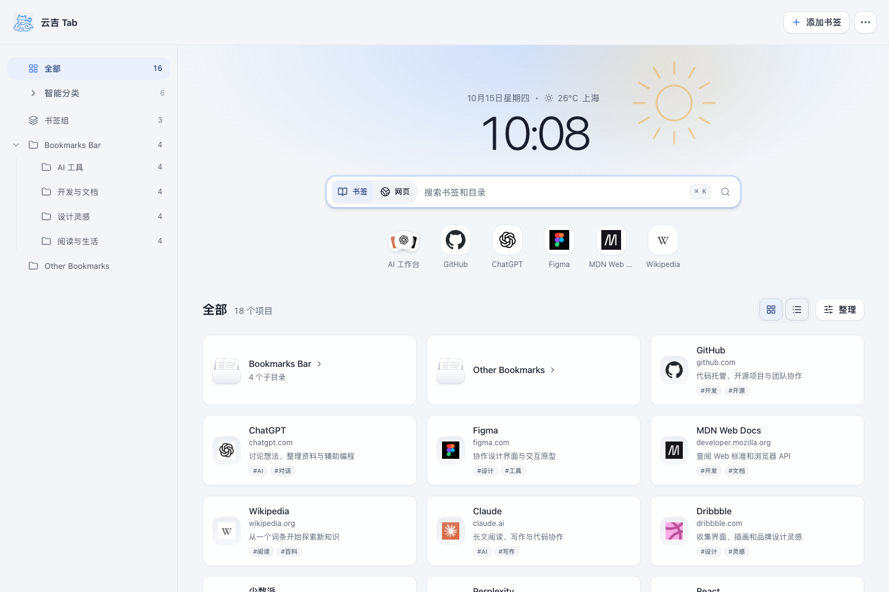

配图使用当前扩展的真实界面与公开示例书签；城市和天气为演示配置，安装后可按需设置。

[安装与上手](#安装与上手) · [查找与打开](#查找与打开) · [收藏与整理](#收藏与整理) · [主页与外观](#主页与外观) · [同步与备份](#同步与备份) · [开发与贡献](#开发与贡献)

## 功能一览

| 你想做什么 | 云吉 Tab 提供什么 |
| --- | --- |
| 打开浏览器就找到常用网站 | 居中首页、工作台布局、书签与书签组混合置顶、时间天气 |
| 找回收藏过的内容 | 名称、网址、描述、标签、目录路径搜索，拼音首字母和模糊匹配，保存筛选 |
| 在收藏和互联网之间切换搜索 | 书签／网页双模式，浏览器默认引擎、搜索关键词和自定义引擎 |
| 把相关网站放在一起 | 书签组、组内别名、自定义图标、悬停展开与拖动排序 |
| 先收藏，稍后整理 | 工具栏快速收藏、右键菜单、浏览器快捷键、收件箱逐条整理 |
| 清理一批书签 | 批量移动、打开、删除、补全描述，目录和书签拖放 |
| 给收藏加上自己的信息 | 描述、标签、Emoji／图片图标、主网址和备用 URL 自动选址 |
| 减少重复整理 | 按标题、域名、网址、描述或标签应用规则；可选 AI 分类预览 |
| 维护长期积累的收藏 | 重复／失效／重定向链接检查，删除撤销、30 天垃圾桶与同步恢复点 |
| 暂存一项工作的打开页面 | 标签页会话、选择性恢复、在新窗口打开 |
| 调整使用习惯 | 八种风格、浅深色、导航位置、卡片字段与密度、自定义快捷键、七种语言 |
| 换设备或保留历史版本 | 浏览器同步、JSON 导入导出、完整快照、可选加密的 WebDAV 备份 |

## 安装与上手

从 [GitHub Releases](https://github.com/kiwiflydream/yunji-tab/releases/latest) 下载 Chrome 安装包：

1. 下载 `yunji-tab-<版本号>-chrome.zip`。页面自动生成的 `Source code` 是源码，不是安装包。
2. 解压 ZIP，确认目录中包含 `manifest.json`。
3. 在 Chrome 打开 `chrome://extensions`，开启右上角「开发者模式」。
4. 点击「加载已解压的扩展程序」，选择解压后的目录。
5. 打开新标签页，已有的浏览器书签会直接显示。

升级时，用新版本文件替换原安装目录的内容，再到扩展管理页点击重新加载，保留安装目录即可，无需卸载。

首次使用可以先做三件事：把几个常用网站置顶；点击时间天气组件选择城市；在右上角「更多操作 › 设置」里选择布局、风格和默认目录。后面的设置路径均从这里进入。

项目主要支持 Chrome。Edge、Brave、Opera 等 Chromium 浏览器可尝试加载同一安装包，目前未逐一验证；Firefox 和 Safari 暂无正式安装包。

## 查找与打开

### 搜索书签、目录，也搜索网页

书签搜索覆盖名称、网址、描述、标签和目录路径，支持模糊匹配与中文拼音首字母。忘记完整标题时，也可以从网站域名、用途或所在目录找起。

| 输入示例 | 查找内容 |
| --- | --- |
| `github` | 与 GitHub 相关的书签或目录 |
| `tag:AI` | 带有 AI 标签的书签 |
| `site:github.com` | GitHub 域名下的收藏 |
| `folder:开发与文档` | 指定目录路径中的内容 |
| `tag:开发 site:github.com` | 同时满足标签与站点条件的收藏 |

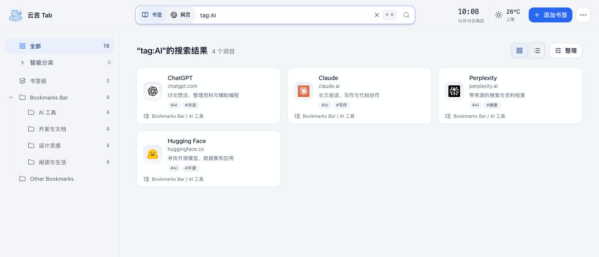

常用查询可以保存为筛选入口：先在「设置 › 常规 › 导航与分类」打开「保存筛选」，搜索后点击结果上方的「保存筛选」。已保存的查询可以从分类栏再次打开，在「设置 › 搜索」删除。

切换到「网页」后，可直接输入网址，或把关键词交给浏览器默认搜索引擎。内置 Google、Bing、DuckDuckGo 和 GitHub，也支持 `g 关键词`、`b 关键词`、`ddg 关键词`、`gh 关键词`。在「设置 › 搜索」中添加自定义引擎、关键词和包含 `%s` 的搜索网址模板。

### 用命令面板快速操作

在主页按 `Cmd/Ctrl + K`，可以搜索书签和目录，也可以直接运行添加书签、清空搜索、健康检查、切换浅深色等操作。方向键选择，`Enter` 执行，`Esc` 关闭。

<p align="center">
  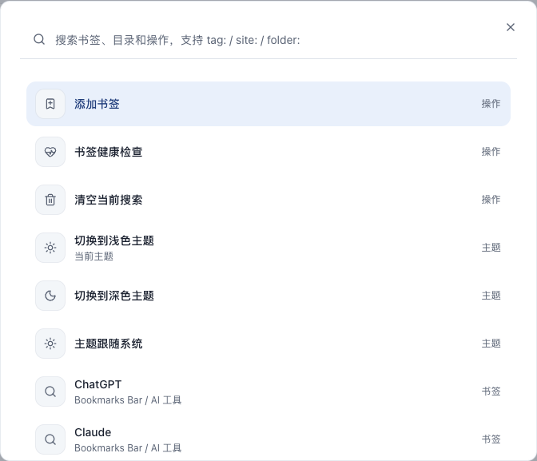
</p>

还可以在普通网页上呼出**全局命令面板**，查找收藏、保存当前页面或回到主页。它默认关闭：先在「设置 › 快捷键」启用，再到 `chrome://extensions/shortcuts` 为全局命令分配按键。浏览器内部页面等受限制的页面无法注入面板，会回到云吉 Tab 主页处理。

### 用书签组组合一项工作

把 ChatGPT、Claude、Perplexity 放进「AI 工作台」，或把项目仓库、文档和设计工具组成一组。进入「书签组 › 创建书签组」，从已有书签中选择成员，填写组名和描述；成员支持组内别名与排序，组本身支持自定义 Emoji 或图片图标。

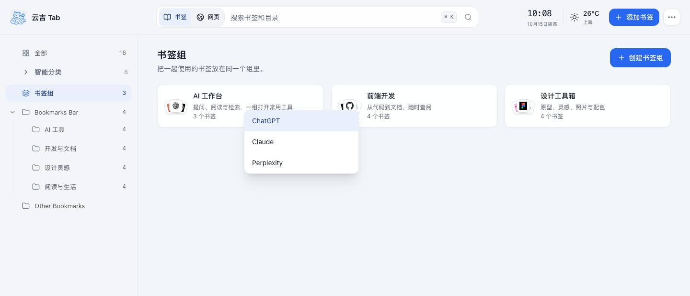

悬停或点击组卡片即可展开成员，选择一个打开。默认图标会把成员网站图标叠成一组卡片。书签组可拖动排序，也可以与普通书签混合置顶，出现在居中首页的快捷入口中。

分组不改变成员原来的文件夹，删除组也不会删除原书签。书签组默认开启，可在「设置 › 常规 › 书签组」关闭并保留配置。

## 收藏与整理

### 随手收藏，再从收件箱归档

浏览网页时，点击扩展工具栏图标即可收藏当前页面，修改标题、选择目录并添加标签；也可以使用网页右键菜单或快速收藏快捷键。已收藏的网址会有重复提示。

快速收藏的书签会进入「智能分类 › 收件箱」，方便把浏览和整理分开。点击「逐条整理」，逐个选择目标目录、补充标签，再「完成并继续」；暂时拿不准的条目可以跳过。也可在批量管理中把选中项目标记为「完成整理」。

<p align="center">
  
</p>

### 浏览目录、智能分类和批量管理

左侧目录沿用浏览器的文件夹层级，支持展开、折叠、新建、重命名、移动和删除，也能为目录设置图标。拖动书签可以调整顺序或移到其他目录，目录本身也可以拖动排序和调整层级。

「智能分类」提供收件箱、置顶、常用、最近、无标签和无描述六个入口。其中常用和最近根据在云吉 Tab 中打开书签的记录生成；无标签、无描述适合集中补齐收藏信息。

列表右上角的「整理」可以切换原生顺序、按名称、最近添加或按常用排序，也可进入「批量管理」，一次移动、打开或删除多个书签，在「更多」中补全描述。卡片视图和紧凑视图可以随时切换。

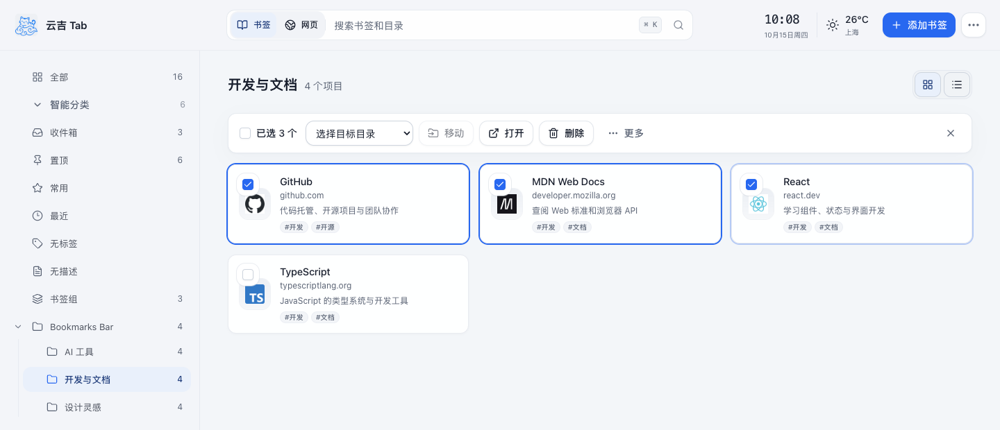

### 描述、标签、图标与备用网址

在书签卡片的「更多操作 › 编辑书签」中修改名称、网址和分类。「更多选项」提供描述、标签、自定义图标和备用 URL，图标支持 Emoji 或图片网址。添加或编辑时也可以主动获取网站信息。

<p align="center">
  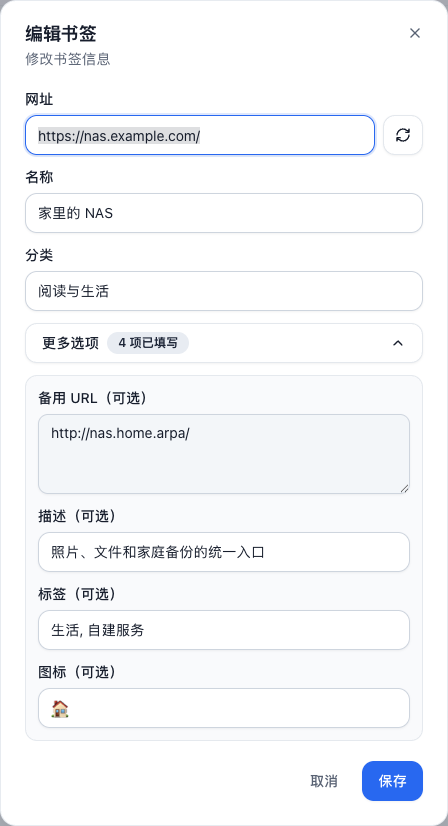
</p>

同一服务有多个入口时，只需保留一个书签。例如主网址填写 `https://nas.example.com/`，备用 URL 填写 `http://nas.home.arpa/`。打开时会同时探测主网址和备用地址，选择最先响应的入口：外出使用外网地址，回家后内网地址也会参与选择，VPN 地址同理。多个备用地址每行一个；所有探测都失败时回退到主网址。

「设置 › 内容补全」可以批量补全缺失的网站描述，并维护忽略域名列表，跳过不希望访问的网站。这项功能读取网页信息，不需要配置 AI。

### 按规则整理，或让 AI 提供分类建议

**规则适合重复、明确的归档习惯。** 在「设置 › 常规 › 高级：自动整理规则」中，选择标题、网址、域名、描述或标签作为条件，以「包含」「等于」「开头是」匹配，然后指定目标目录、追加标签，并按需移出收件箱。例如把域名包含 `github.com` 的收藏归入开发目录，并加上「开源」标签。页面会显示匹配数量，点击「应用规则」执行；规则不会持续在后台自动运行。

**AI 适合重新梳理一批难以分类的收藏。** 在「设置 › AI」中连接自己的 OpenAI 兼容服务，配置 Base URL、Token 和模型，可获取模型列表、验证连接、自定义分类提示词及每批数量。

1. 点击「生成分类预览」，等待分类建议；分析过程中可暂停、继续或终止。
2. 查看原目录、目标目录和建议，取消不想移动的项目。
3. 点击「确认移动」后才实际调整目录，最近一次 AI 分类可在 24 小时内撤销。

生成预览不会修改书签，关闭设置也不会丢失已完成的结果。AI 会接收书签标题、去除查询参数的网址、描述、标签和目录路径；Token 不参与同步或备份，可选择仅在当前浏览器会话使用。AI 为可选功能，普通收藏和整理不依赖它。

### 健康检查、撤销与历史

右上角「更多操作 › 书签健康检查」可查找重复、失效和重定向链接。检查结果按问题筛选，支持选择保留的重复项并合并、更新重定向后的地址，或删除不再需要的书签。网络错误与真正失效的链接需要结合结果判断，检查不会自动删除收藏。

通过云吉 Tab 删除的书签或目录可立即撤销，也可在「更多操作 › 垃圾桶与历史」中查看删除快照并在 30 天内恢复。这里还能查看最近操作和远端同步覆盖本机补充数据前保存的恢复点。

有进行中或失败的任务时，「更多操作」会显示「任务中心」入口，可查看同步、描述抓取、检查和恢复的执行状态。

### 保存一组打开的标签页

研究一个主题时开了很多页面，可以在「更多操作 › 标签页会话」中为当前窗口保存一个会话。支持排除固定标签页、用当前窗口更新已有会话、选择部分页面恢复，以及恢复到新窗口；页面按保存的顺序打开。

会话最多保存 50 组，每组最多 100 个去重后的 HTTP／HTTPS 页面。会话只保存在当前浏览器，不参与跨设备同步或完整快照备份。

## 主页与外观

### 居中首页与工作台

首次安装默认使用晴空风格和居中布局：日期、天气、大号时钟、搜索框和置顶入口集中在首屏。置顶入口同时包含书签和书签组，最多显示 10 项，悬停组入口可展开成员。关闭时间和天气后，会收起对应区域，只留下搜索与常用入口。

需要更多空间浏览和管理书签时，可以切换到工作台，把搜索和时间天气收进顶栏。

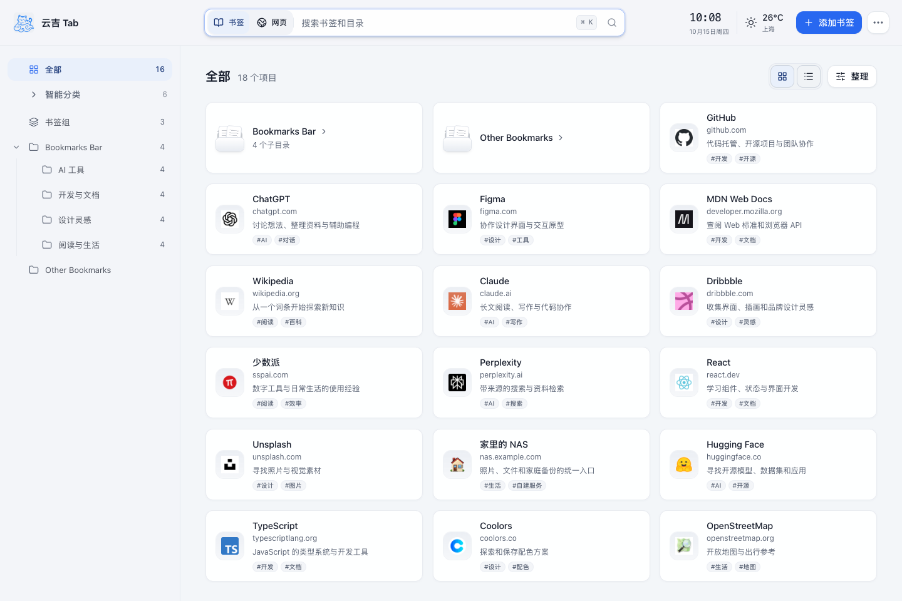

在「更多操作」或「设置 › 常规 › 首页布局」切换，两种布局会平滑过渡。旧外观配置缺少布局选项时沿用工作台，已经选择过的布局保留；居中布局向下滚动到搜索框被顶栏盖住后，顶栏会临时接管搜索和时间天气。

常规设置还可选择默认打开的目录、把分类栏放在左侧或顶部、调整智能分类与计数的显示，以及开启单主页标签复用。

### 八种风格与细节自定义

「设置 › 外观」提供**晴空、简洁、平衡、紧凑、柔和、纸墨、蓝墨版画、电光蓝**八种整体风格。一般风格可选择浅色、深色或跟随系统，纸墨和电光蓝固定浅色，蓝墨版画固定深色；高级自定义可调整内容宽度、网格密度、卡片样式、圆角、图标尺寸和显示字段。

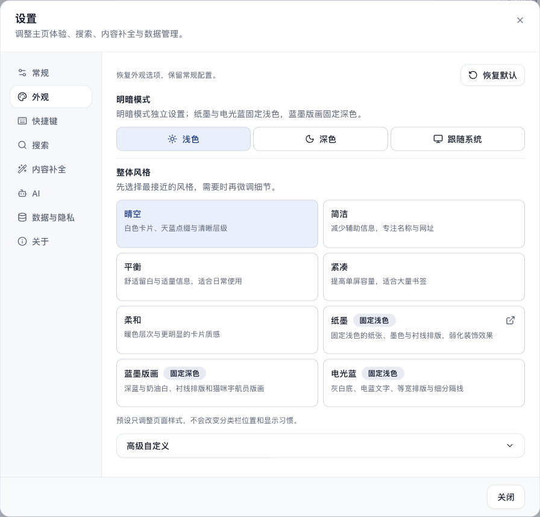

描述、标签、目录路径、标题与描述行数、可见标签数量、操作按钮的显示方式都可调整。「卡片图标」统一控制书签、目录与书签组的图标，「菜单图标」控制分类导航图标，切换主题和刷新后保留选择。

蓝墨版画采用深蓝和奶油白、衬线字体与印刷颗粒，配有项目原创的猫咪宇航员插画。插画固定在视窗底部，滚动书签时仍然可见。

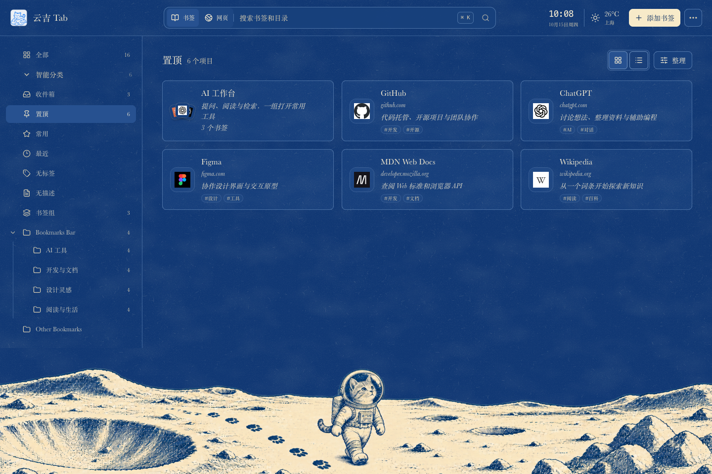

电光蓝使用灰白底、电蓝文字和本地等宽字体，固定为浅色，禁用强调色与背景选择，保留导航位置和图标显示偏好。更多说明见[电光蓝主题文档](./docs/theme-electric-blue.md)。

「常规」和「外观」页都可恢复本页默认设置，保留书签、书签组与自动整理规则。常规重置会将语言恢复为浏览器语言。界面动效尊重系统的减少动态效果设置。

### 时间与天气

点击主页时间天气组件，或进入「设置 › 常规 › 时间与天气」，可以独立开关时间和天气、显示日期、切换 12／24 小时制、搜索城市和选择摄氏或华氏。时间跟随设备时区；天气使用手动选择的城市，按需申请 Open-Meteo 访问权限，不自动读取设备位置。

<p align="center">
  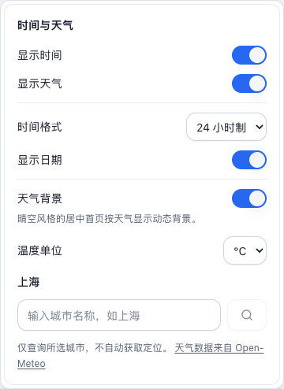
</p>

晴空风格的居中布局会随天气改变首屏背景：晴天的太阳、夜晚的弯月与星星、多云时的祥云，以及雨、雪、雾和雷暴效果。未设置城市或天气不可用时保持静态背景，也可单独关闭「天气背景」。

## 同步与备份

### 跨设备同步

原生书签由浏览器负责同步；云吉 Tab 保存描述、标签、图标、备用 URL、置顶、收件箱状态等补充信息，默认通过浏览器同步存储同步。设置和书签组也可跨设备使用。两台设备需使用同一 Chrome 账号、开启浏览器同步并安装云吉 Tab。

在「设置 › 数据与隐私」可以查看状态、立即同步、选择补充数据的同步字段，或启用口令加密。**书签组使用独立的同步存储，不受补充数据的字段选择和口令加密保护。**使用记录、标签页会话、垃圾桶和操作历史保存在本机；使用记录可随完整快照备份。

### 本地备份与 WebDAV

| 方式 | 适合什么情况 |
| --- | --- |
| 导出／导入 JSON | 保存和恢复描述、标签、图标、书签组等扩展补充数据与配置 |
| 完整快照／恢复快照 | 备份原生书签树、目录层级、补充数据、书签组、使用记录与设置 |
| WebDAV 备份 | 把完整快照上传到自己的云盘或服务器，保留多个历史版本，可选加密 |

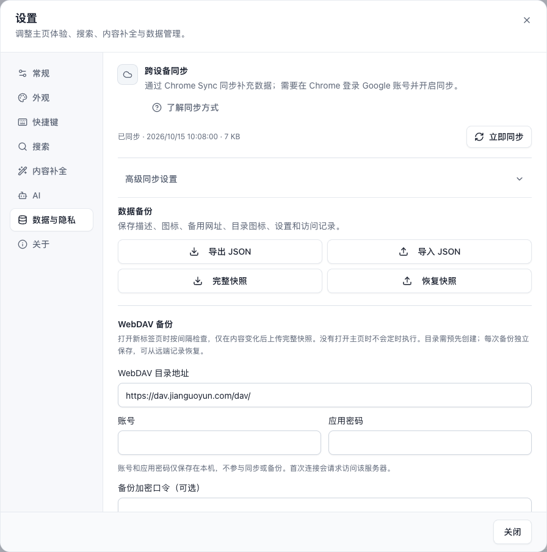

WebDAV 支持手动备份，或在打开新标签页时按间隔检查，仅在内容变化后自动上传。每次上传独立文件，可从远端历史记录恢复；填写备份加密口令后，使用 AES-256-GCM 加密包含书签组的完整快照。它与浏览器同步口令独立，手动导出的本地 JSON 仍为明文。

恢复完整快照前会显示预览。确认后，原生书签树导入新的 `Yunji Tab Restore ...` 文件夹，保留现有原生书签；**同网址的补充数据与使用记录、同 ID 的书签组以及应用设置会恢复为快照中的值，其他现有书签组保留。**快照不包含标签页会话、垃圾桶、操作历史、缓存、AI Token、WebDAV 凭据或加密口令。

配置坚果云或其他 WebDAV 服务、自动备份间隔、加密口令和历史恢复规则，见[备份与恢复指南](./docs/backup.md)。

### 隐私与权限

无需云吉 Tab 账号，不收集分析数据。网站图标会按需向 Google Favicon 发送域名；天气、网页信息、健康检查、AI 和 WebDAV 会在使用相应功能时访问对应服务，申请必要的网站权限。设置中可撤销可选授权、清理缓存和本地记录。

AI 服务由你自行配置，Token 不参与同步或备份；WebDAV 连接凭据与备份口令仅保存在本机。各类数据的存放位置、网络请求和权限用途见[隐私与权限说明](./docs/privacy.md)。

## 快捷键与语言

| 默认快捷键 | 操作 |
| --- | --- |
| `/` | 聚焦主页搜索框 |
| `Cmd/Ctrl + K` | 打开主页命令面板 |
| `N` | 新增书签 |
| 方向键、`Enter` | 选择并打开书签或命令 |
| `Esc` | 清空搜索或关闭当前弹层 |
| `Alt + Shift + B`（macOS：`Command + Shift + B`） | 快速收藏当前网页 |
| 自行分配 | 在普通网页呼出全局命令面板 |

主页快捷键可在「设置 › 快捷键」录入修改，支持冲突提示和恢复默认；浏览器级快捷键在 `chrome://extensions/shortcuts` 设置。

界面支持简体中文、繁体中文、英语、日语、韩语、西班牙语和法语，可在常规设置中切换。

## 开发与贡献

基于 Plasmo、React 19、TypeScript、Tailwind CSS 和 Zustand 开发。准备 Node.js 22 或更高版本以及 pnpm 10.34.4：

```bash
corepack enable
pnpm install --frozen-lockfile
pnpm dev
```

开发时加载 `build/chrome-mv3-dev/`。生产构建、单元测试、扩展端到端测试、目录结构和文档截图更新方式见[开发指南](./docs/development.md)。

欢迎通过 [Issues](https://github.com/kiwiflydream/yunji-tab/issues) 提交问题和建议，也欢迎贡献代码。报告问题时请附复现步骤、浏览器版本和截图，并隐藏私人网址与凭据。

[开发指南](./docs/development.md) · [备份与恢复](./docs/backup.md) · [隐私与权限](./docs/privacy.md) · [设计规范](./DESIGN.md) · [更新记录](https://github.com/kiwiflydream/yunji-tab/releases)

## 许可证

[MIT](./LICENSE) © 2026 KIWI
