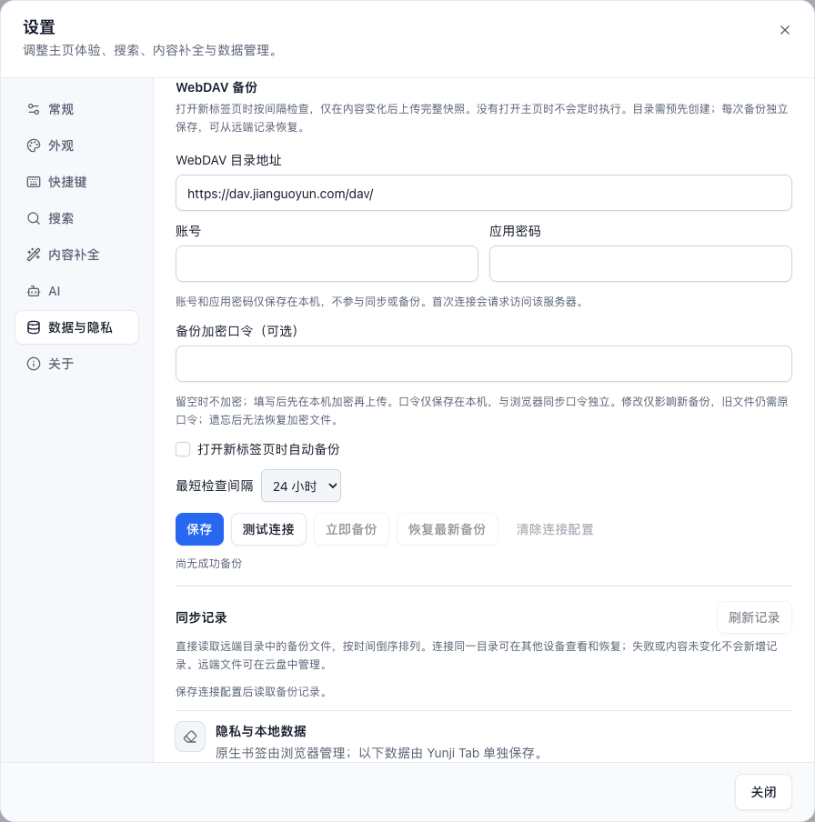

# 备份与恢复

简体中文 · [English](./backup.en.md) · [返回 README](../README.md)

打开「设置 › 数据与隐私」，可以导出、导入书签的补充数据，也可以用「完整快照」备份书签树及相关配置。WebDAV 使用同一份完整快照，备份范围如下：

| 包含 | 不包含 |
| ---- | ------ |
| 原生书签树、文件夹层级与顺序 | 标签页会话、垃圾桶、操作历史和缓存 |
| 描述、标签、自定义图标、备用 URL、置顶和收件箱状态 | AI API Token、WebDAV 连接配置和加密口令 |
| 书签组及成员顺序、目录图标、打开次数和最近访问时间、应用设置 | 浏览器同步的加密口令 |

## 恢复时会发生什么

完整快照恢复前会显示预览，确认后将原生书签树导入新的 `Yunji Tab Restore ...` 文件夹，保留现有原生书签。**同网址的补充数据和使用记录会恢复为快照中的值，书签组按 ID 恢复：同 ID 的组会被快照替换，当前已有的其他组会保留；应用设置会被快照替换。**这些恢复后的数据仍按浏览器和扩展的同步设置参与跨设备同步。

## 配置 WebDAV

1. 填写目录地址，默认是坚果云 `https://dav.jianguoyun.com/dav/`，也可改为其他 WebDAV 服务或子目录。自定义目录需先在云盘中创建，远程服务需使用 HTTPS。
2. 填写账号和应用密码。坚果云账号为登录邮箱，应用密码在「账户信息 › 安全选项 › 第三方应用管理」中创建。
3. 按需填写「备份加密口令」，保存配置并测试连接；首次连接会申请该服务器的网站访问权限。
4. 手动备份，或开启「打开新标签页时自动备份」。自动备份默认关闭，开启后默认以 24 小时为最短检查间隔，也可选择 1、6 或 72 小时；达到间隔且内容变化时才上传。没有打开主页时不会定时运行，不需要 `alarms` 或通知权限。手动备份不受间隔和内容去重限制。

## 加密与口令

「备份加密口令」留空时上传普通 JSON；填写并保存一次后，后续手动、自动备份都会复用本机口令，使用 AES-256-GCM 加密完整快照，包含书签组。口令与补充数据的浏览器同步口令独立，仅保存在本机，不写入远端文件或快照。修改或清空口令只影响之后的备份，旧文件仍需创建时的口令。恢复时先尝试本机口令，缺少或不匹配时可临时输入；临时口令不修改已保存配置，解密成功后仍需预览并确认。遗忘口令后无法恢复对应的加密备份。

这项口令只用于 WebDAV 备份，手动导出的本地 JSON 仍为明文。

## 历史记录与跨设备恢复

每次备份只上传一个独立 JSON，例如 `yunji-tab-backup-20261011T114025123Z-<随机 ID>.json`。文件名包含 UTC 时间（精确到毫秒）和随机 ID，避免覆盖历史版本。「同步记录」直接读取远端目录的文件列表，按时间倒序显示，支持刷新、恢复最新备份或恢复某条记录。换设备后连接同一目录即可查看记录；加密文件还需相应口令。上传失败或内容未变化时只显示当前状态，不产生文件记录。

记录不在本地持久保存，也不额外上传索引。旧版固定文件 `yunji-tab-full-snapshot.json` 和 `yunji-tab-snapshot-<随机 ID>.json` 也会显示，时间取服务器修改时间。扩展不自动删除远端文件，可在云盘中自行清理；清除连接配置只删除本机凭据、口令和检查状态，保留远端文件。

